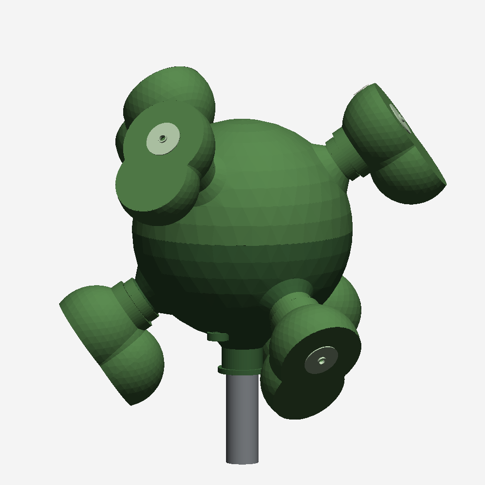
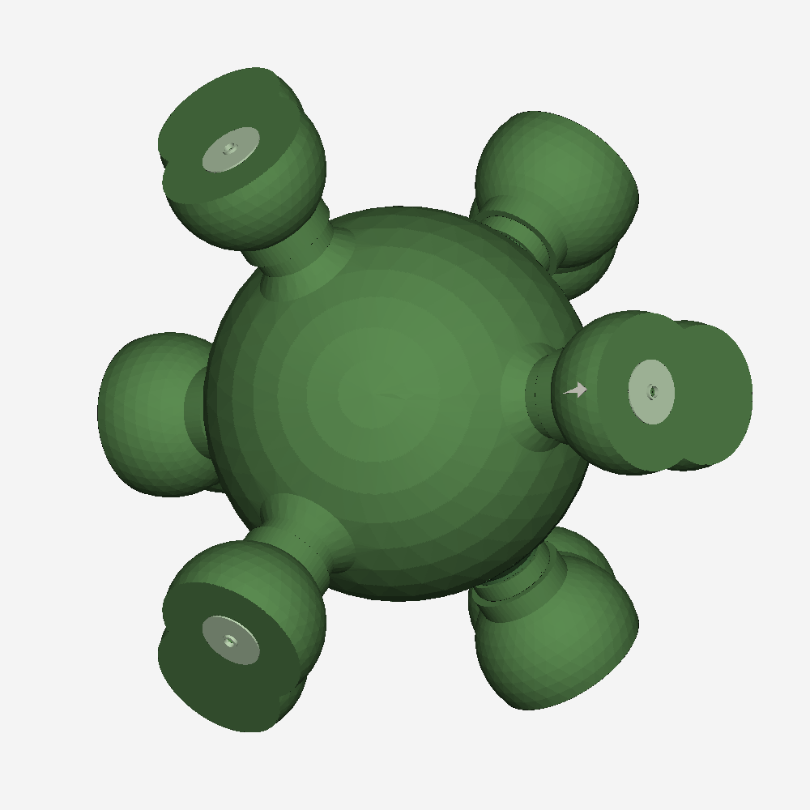
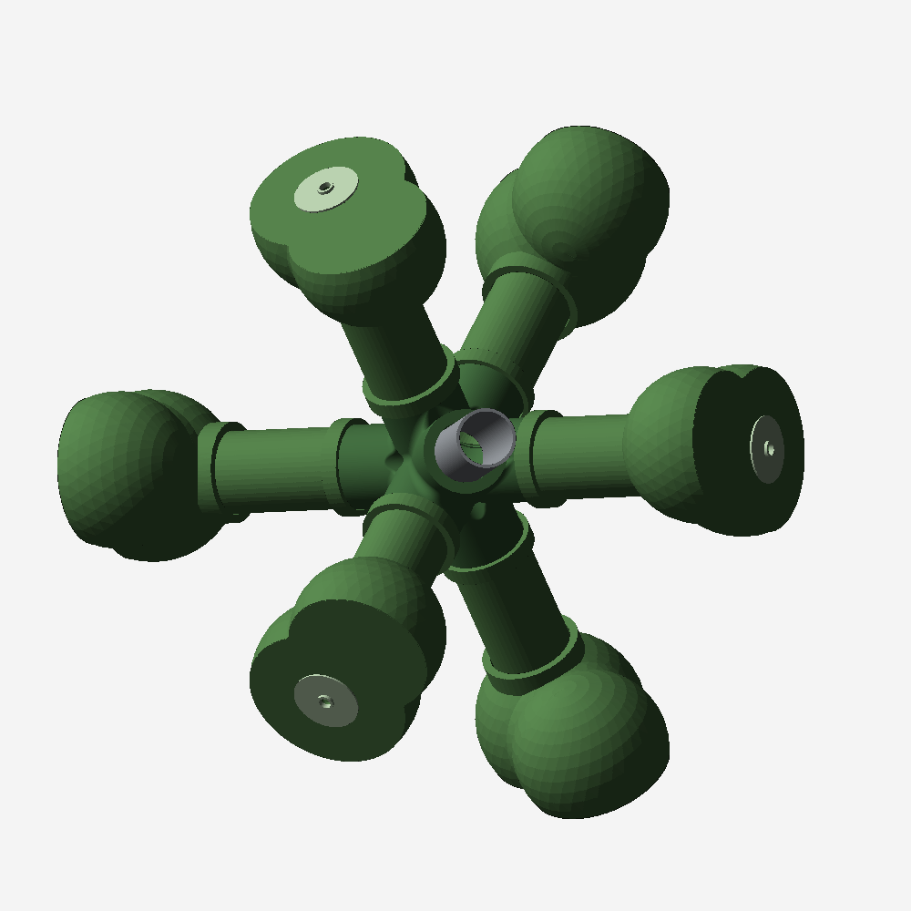
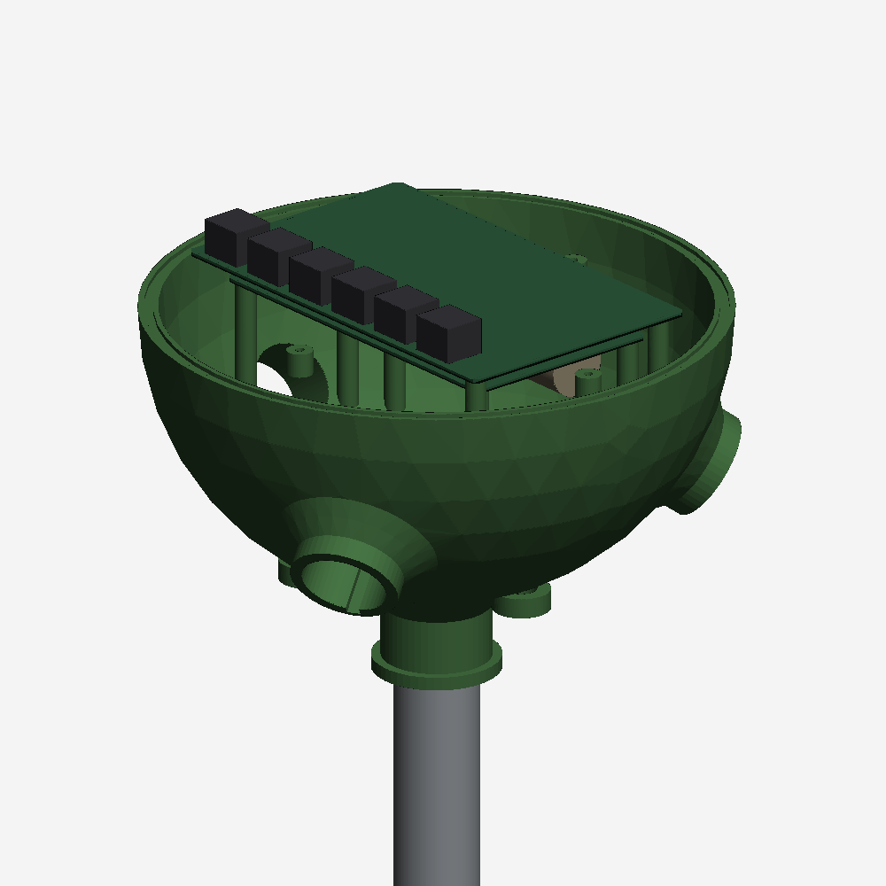
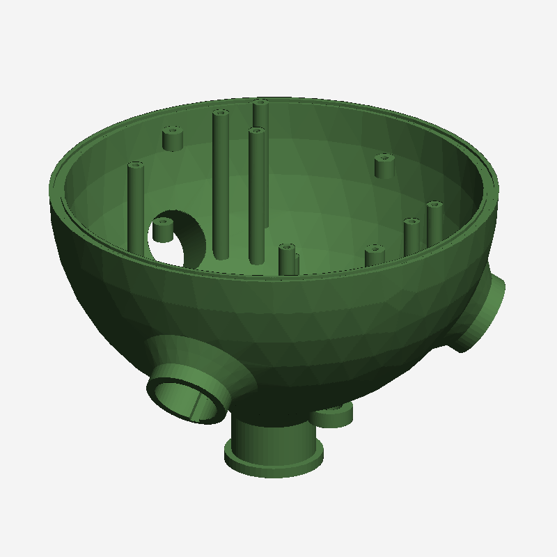
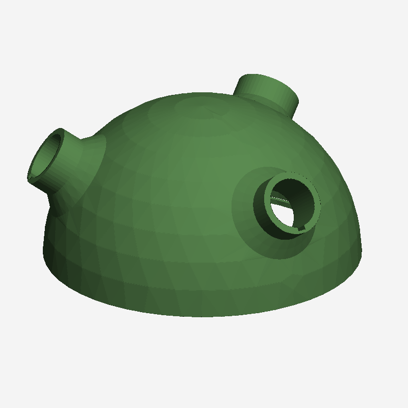
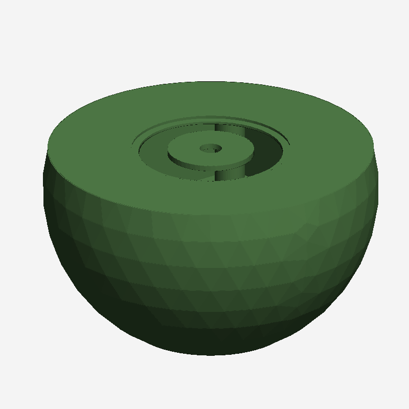

# Kryt het68

Tisknutelný kryt akustického pole [het68](https://github.com/fedurca/het68). Krychle o hraně 384 mm stojí na vrcholu, mikrofon je ve středu každé stěny a kouká ven po její normále. Protilehlé membrány T5848 jsou od sebe 384 mm.

Střed je koule. V ní leží Core 160 × 100 mm a silová deska 140 × 80 mm z [het68_pcb v7.4.1](https://github.com/fedurca/het68_pcb/releases/tag/v7.4.1), obě uprostřed. Silová deska má článek 21700 směrem ke stožáru, Core má šest svislých RJ45 směrem nahoru. Plášť má v každém směru stejný poloměr, takže odraz od těla je všude stejný.

Satelit 52 × 52 mm je v každé růžičce, mikrofon uprostřed desky. Ven z desky kouká jen otvor T5848 a kruh osmi SK6812. Svislý RJ45 je na zadní straně a patch kabel Cat6 jde stopkou do svého RJ45 na Core. Šest kabelů má stejnou délku. Díra stopky je Ø28,4 mm, zástrčka RJ45 jí projde.

Stopka překrývá hrdlo zvonem, růžička překrývá stopku návlekem, víčko LED sedí v osazení. Kolem stožáru jsou tři otvory Ø12 mm po 120° na piezoelektrické měniče. Stožár je skutečná trubka HT DN 32 ve slepém hrdle, zasunutá 40 mm.

Firmware pro tuto mechaniku se překládá s `HET68_DOA_EDGE_MM=384`. Směry mikrofonů jsou `MIC_DIR` z [doa.c](https://github.com/fedurca/het68/blob/main/doa.c), návrh pole je v [array_cube_design.md](https://github.com/fedurca/het68/blob/main/array_cube_design.md). Míry desek a koruny jsou v [reference/GEOMETRY.md](reference/GEOMETRY.md).

Tělo je zelená ASA: kulová koruna, stopky Ø44 mm, růžičky z jedné koule. Víčko kruhu LED je přírodní průsvitná ASA a slouží jako difuzor, před mikrofon nepatří. Tištěný čep do koruny má Ø31,7 × 28 mm. Žebro čepu a zub bajonetu jsou na straně, která po nasazení míří k zemi, takže RJ45 satelitu je nejníž.

## Sestava

Šest stejných stopek míří ve směru `MIC_DIR`. Mikrofon 1 je sever, elevace +35°. Šipka na jeho růžičce leží na horní straně a v sestavě ukazuje k severu. Šedá trubka je stožár, zasunutý 40 mm do slepého hrdla. Není to tištěný díl.

Délka kabelů a hloubka zasunutí stožáru jsou v [export/CUT_LENGTHS.txt](export/CUT_LENGTHS.txt).

## Díly

Tištěné díly jsou v [export/stl](export/stl) a [export/step](export/step). Koruna je půlená v rovníku. Dutina je koule Ø194 mm. Zvenku je plášť koule Ø206 mm.

### Koruna, spodek

Tři dolní hrdla, svislý stonek se slepým hrdlem a tři otvory Ø12 mm na měniče. V dutině jsou sloupky: čtyři na díry silové desky a čtyři na díry Core. Silová deska sedí článkem dolů, Core leží nad ní konektory nahoru. V rovníku je drážka na O-kroužek Ø2,5 mm.

[hub_lower.stl](export/stl/hub_lower.stl) · [hub_lower.step](export/step/hub_lower.step)

### Koruna, vršek

Tři horní hrdla a jazýček do spodní dutiny. Vnější plocha navazuje bez příruby.

[hub_upper.stl](export/stl/hub_upper.stl) · [hub_upper.step](export/step/hub_upper.step)

### Stopka

Jeden díl pro všech šest směrů. Do koruny jde čep Ø31,7 × 28 mm s žebrem, přes hrdlo je zvon. Mezi korunou a růžičkou je stonek Ø44 mm s dírou Ø28,4 mm, na konci límec Ø40 mm s jedním bajonetovým zubem. Žebro a zub jsou na stejné straně. Ta strana po nasazení míří k zemi.

[arm.stl](export/stl/arm.stl) · [arm.step](export/step/arm.step)

### Růžička

Drží satelit 52 × 52 mm z v7.4.1, světlost 56 × 56 mm. T5848 je ve středu (26, 26), na stejném místě jako střed kruhu LED o poloměru 16 mm. Svislý RJ45 je na zadní straně, střed těla (26, 10,4), zástrčka míří do stopky. Tělo je jedna koule seříznutá v rovině mikrofonu. Návlek na stopce kryje bajonet. Nasazení je pootočené o 30° a dotočené tak, aby RJ45 byl dole.

[pod.stl](export/stl/pod.stl) · [pod.step](export/step/pod.step)

### Víčko LED

Průsvitný kroužek přes SK6812. Lem dosedne na čelo hlavice, krátký nákružek zapadne do prstence. Uprostřed zůstává díra a límec na pěnový windscreen.

[pod_window.stl](export/stl/pod_window.stl) · [pod_window.step](export/step/pod_window.step)

### Značka severu

Šipka pro druhou barvu, převýšení 0,8 mm. Soubor je ve stejném souřadném systému jako `pod.stl`, na horní stěně hlavice mikrofonu 1. V sestavě míří k severu.

[marks.stl](export/stl/marks.stl) · [marks.step](export/step/marks.step)
