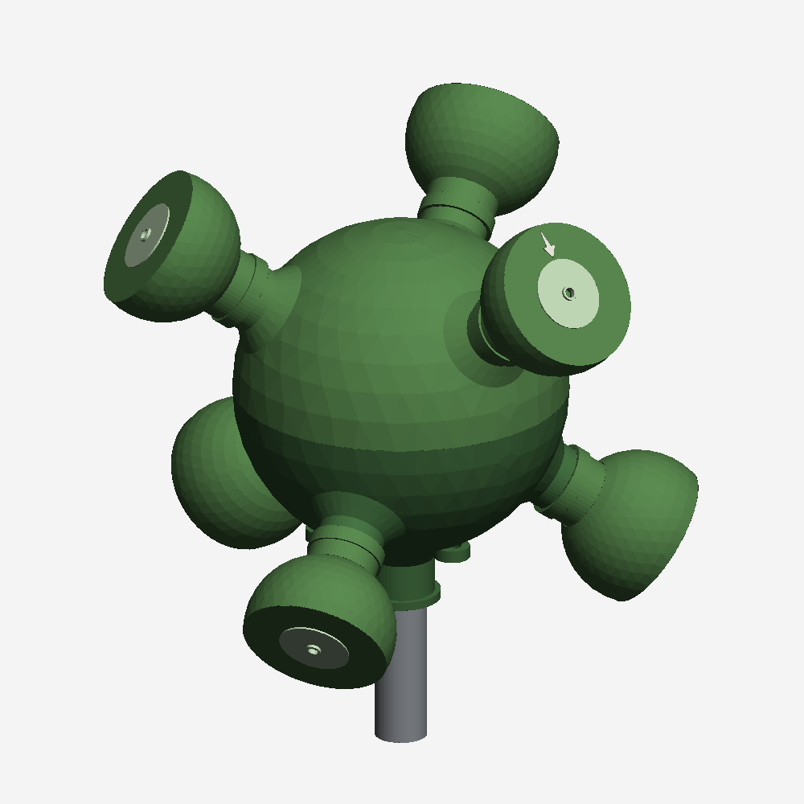
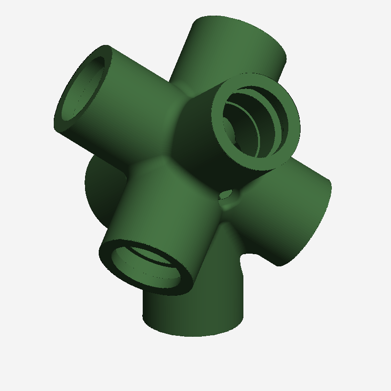
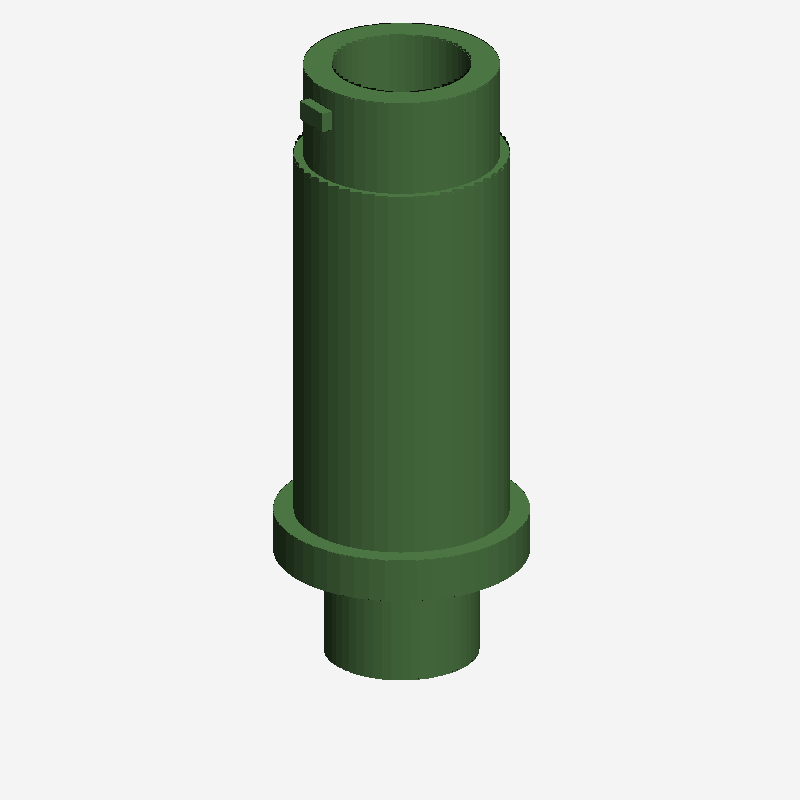
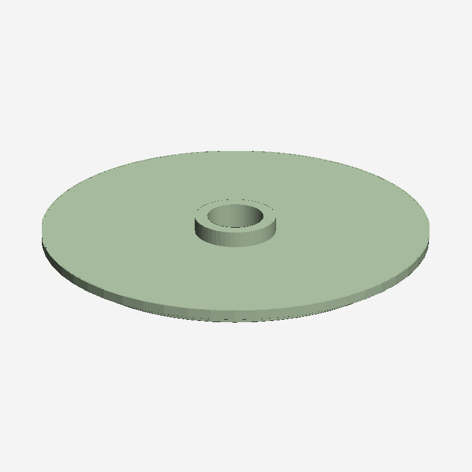
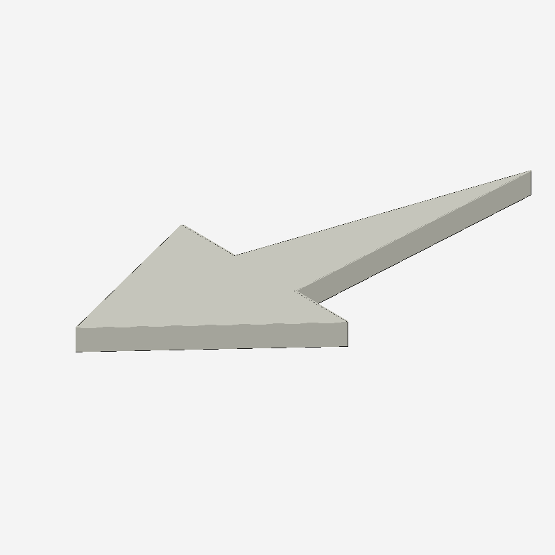

# Kryt het68

Tisknutelný kryt akustického pole [het68](https://github.com/fedurca/het68). Krychle o hraně 384 mm stojí na vrcholu, mikrofon je ve středu každé stěny a kouká ven po její normále. Protilehlé membrány T5848 jsou od sebe 384 mm.

Střed sestavy je dodaná spojka [`reference/stl/spojka-echo.stl`](reference/stl/spojka-echo.stl). Tištěný soubor [`export/stl/hub.stl`](export/stl/hub.stl) má stejných 257764 trojúhelníků, jen otočených tak, aby šest pravoúhlých hrdel mířilo ve směrech `MIC_DIR` a sedmé hrdlo, po tělesové úhlopříčce, stálo svisle dolů. V síti jsou průchody kabelů a tři otvory po 120° na piezoelektrické měniče pro prostorovou echolokaci.

Šest stopek je jeden díl a končí růžičkou s mikrofonem. Čep Ø31,7 × 28 mm vleze do hrdla, jehož díra má poloměr 16,6 mm. Příruba dosedne na ústí 60 mm od středu. Kabel od roviny T5848 do středu spojky měří **192 mm** v každém směru, hrdlo je provrtané skrz. Stožár je skutečná trubka HT DN 32 ve svislém hrdle, zasunutá 40 mm.

Stoh Core 160 × 100 mm a silové desky 140 × 80 mm z [het68_pcb v4.5.0](https://github.com/fedurca/het68_pcb/releases/tag/v4.5.0), obálka 160 × 100 × 54 mm, se do této spojky nevejde. Průchody se ve středu kříží.

Stopka překrývá ústí zvonem, růžička překrývá stopku návlekem, víčko LED sedí v osazení. Dovnitř růžičky vede jen otvor T5848 s límcem na windscreen.

Firmware pro tuto mechaniku se překládá s `HET68_DOA_EDGE_MM=384`. Směry mikrofonů jsou `MIC_DIR` z [doa.c](https://github.com/fedurca/het68/blob/main/doa.c), návrh pole je v [array_cube_design.md](https://github.com/fedurca/het68/blob/main/array_cube_design.md). Podklady a naměřené míry spojky jsou v [reference/GEOMETRY.md](reference/GEOMETRY.md).

Tělo je zelená ASA. Spojka se tiskne jako jeden díl z dodané sítě. Stopky a růžičky ze tří srostlých kuliček se tisknou zvlášť. Víčko kruhu LED je přírodní průsvitná ASA a slouží jako difuzor, před mikrofon nepatří. Hladký úsek čepu má stěnu 1,8 mm, stonek mezi spojkou a růžičkou má Ø44 mm. Hrdlo spojky je kruhové, bez drážky, takže se stopka lepí zubem bajonetu směrem k zemi.

## Sestava

Šest stejných stopek míří ve směru `MIC_DIR`. Mikrofon 1 je sever, elevace +35°. Šipka na jeho růžičce leží na horní straně a v sestavě ukazuje k severu. Šedá trubka je stožár, zasunutý 40 mm do svislého hrdla. Není to tištěný díl.

Délka kabelu a hloubka zasunutí stožáru jsou v [export/CUT_LENGTHS.txt](export/CUT_LENGTHS.txt).

## Díly

Tištěné díly jsou v [export/stl](export/stl). Stopka, růžička, víčko a šipka mají i STEP v [export/step](export/step). Spojka je síť, STEP z ní není.

### Spojka

Sedm hrdel z dodaného modelu. Šest končí 60 mm od středu a bere stopky, sedmé míří dolů a bere stožár. Díra šesti hrdel má poloměr 16,6 mm, ústí se rozšiřuje na poloměr 22,5 mm. Tři otvory na měniče leží v síti kolem stožáru. Soubor má stejné trojúhelníky jako podklad.

[hub.stl](export/stl/hub.stl)

### Stopka

Jeden díl pro všech šest směrů. Do spojky jde hladký čep Ø31,7 × 28 mm, přes ústí je zvon s vnitřním poloměrem 23,2 mm. Mezi spojkou a růžičkou je stonek Ø44 mm s dírou Ø28,4 mm, na konci límec Ø40 mm s jedním bajonetovým zubem. Zub po nalepení míří k zemi, takže konektorová hrana satelitu je nejníž.

[arm.stl](export/stl/arm.stl) · [arm.step](export/step/arm.step)

### Růžička

Drží satelit 50 × 80 mm, světlost 56 × 86 mm. Tělo jsou tři srostlé kuličky seříznuté v rovině mikrofonu, ať růžička čte jako brokolice. Ven vede jen otvor T5848 a prstenec osmi SK6812, víčko LED se lepí do osazení. Návlek na tlustší stopce kryje bajonet. Nasazení je pootočené o 30° a dotočené tak, aby hrana s RJ45 byla dole.

[pod.stl](export/stl/pod.stl) · [pod.step](export/step/pod.step)

### Víčko LED

Průsvitný kroužek přes SK6812. Lem dosedne na čelo hlavice, krátký nákružek zapadne do prstence. Uprostřed zůstává díra a límec na pěnový windscreen.

[pod_window.stl](export/stl/pod_window.stl) · [pod_window.step](export/step/pod_window.step)

### Značka severu

Šipka pro druhou barvu, převýšení 0,8 mm. Soubor je ve stejném souřadném systému jako `pod.stl`, na horní stěně hlavice mikrofonu 1. V sestavě míří k severu.

[marks.stl](export/stl/marks.stl) · [marks.step](export/step/marks.step)
