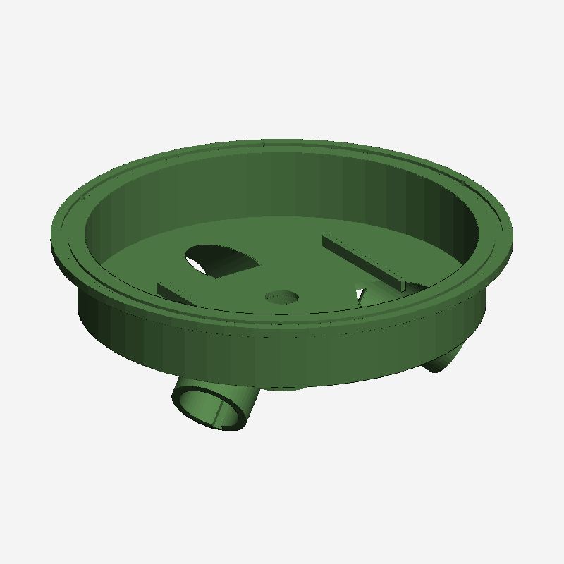
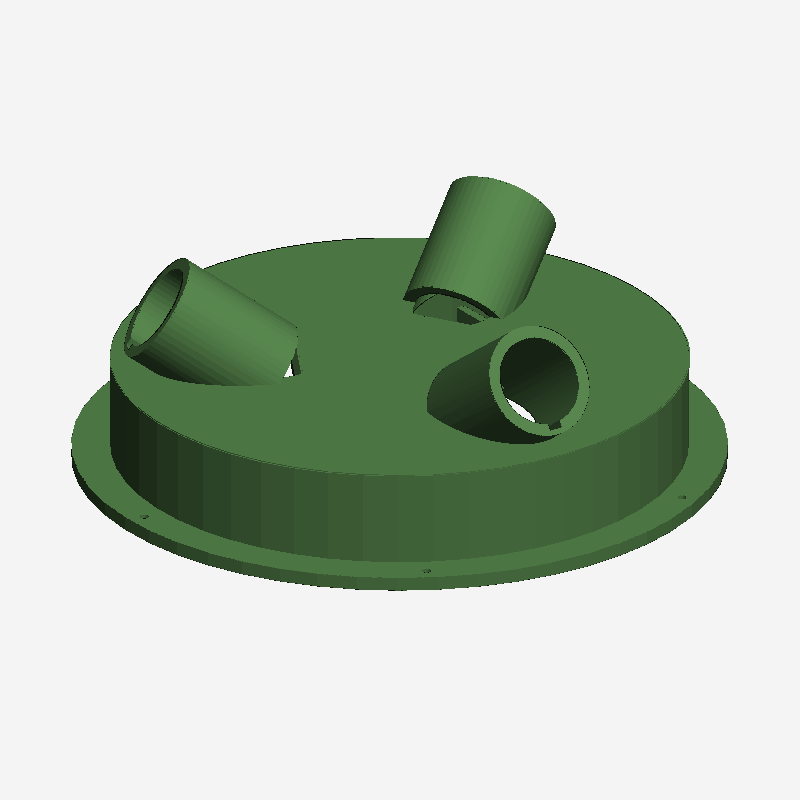

# Kryt het68

Tisknutelný kryt akustického pole [het68](https://github.com/fedurca/het68). Krychle o hraně 384 mm stojí na vrcholu, mikrofon je ve středu každé stěny a kouká ven po její normále. Protilehlé membrány T5848 jsou od sebe 384 mm.

Core 160 × 100 mm a silová deska 140 × 80 mm z [het68_pcb v4.5.0](https://github.com/fedurca/het68_pcb/releases/tag/v4.5.0) leží ve středu detekční krychle, uvnitř sedmispojky. Šest satelitních kabelů tak má stejnou délku **129,6 mm** od membrány k dutině. Sedmý port je svislý stožár. Plášť je válec: všech šest směrů má stejnou složku |z|, takže každé rameno potkává víko ve stejné vzdálenosti a vzájemně si do zvuku zasahují stejně.

Firmware pro tuto mechaniku se překládá s `HET68_DOA_EDGE_MM=384`. Směry mikrofonů jsou `MIC_DIR` z [doa.c](https://github.com/fedurca/het68/blob/main/doa.c), návrh pole je v [array_cube_design.md](https://github.com/fedurca/het68/blob/main/array_cube_design.md). Starý kříž, fotka prototypu a naměřené míry jsou v [reference/GEOMETRY.md](reference/GEOMETRY.md).

Tělo je zelená ASA. Víčko kruhu LED je přírodní průsvitná ASA a slouží jako difuzor, před mikrofon nepatří. Hladký úsek DN 32 má stěnu 1,8 mm, hlavice 3 mm, plášť sedmispojky 3,5 mm. Tištěný čep má Ø31,7 × 40 mm, aby vlezl do skutečného hrdla. Tištěné hrdlo má díru Ø32,4 mm, aby do něj vlezla trubka Ø32 mm.

## Sestava

Šest stejných ramen míří ve směru `MIC_DIR`. Mikrofon 1 je sever, elevace +35°. Šipka na jeho hlavici leží na horní stěně a v sestavě ukazuje k severu. Šedá trubka je stožár v ose sedmispojky, zasunutý 40 mm. Není to tištěný díl.

Délka kabelu a hloubka zasunutí stožáru jsou v [export/CUT_LENGTHS.txt](export/CUT_LENGTHS.txt).

## Díly

Tištěné díly jsou v [export/stl](export/stl) a [export/step](export/step). Sedmispojka je půlená v rovníku, ať se do ní vejde stoh 160 × 100 × 54 mm. Světlost dutiny je Ø204 × 72 mm, deska je uprostřed.

### Sedmispojka, spodek

Tři dolní hrdla DN 32 a svislé hrdlo stožáru. V přírubě je drážka na O-kroužek Ø2,5 mm a šest děr M3. Lišty nesou desku, mimo ústí kabelů.

[hub_lower.stl](export/stl/hub_lower.stl) · [hub_lower.step](export/step/hub_lower.step)

### Sedmispojka, vršek

Tři horní hrdla, příruba se šesti dírami M3 a středicí lem do spodní dutiny. Po zavření svírá stoh shora.

[hub_upper.stl](export/stl/hub_upper.stl) · [hub_upper.step](export/step/hub_upper.step)

### Rameno

Jeden díl pro všech šest směrů. Čep Ø31,7 × 40 mm, nákružek jako doraz, hladká trubka DN 32 a límec s jedním bajonetovým zubem. Žebro u čepu a zub jsou na stejné straně. Ta strana po nasazení míří k zemi, takže konektorová hrana satelitu je nejníž.

[arm.stl](export/stl/arm.stl) · [arm.step](export/step/arm.step)

### Hlavice

Drží satelit 50 × 80 mm, světlost 56 × 86 mm. Ven vede jen otvor T5848 a prstenec osmi SK6812. Deska se zasouvá od rozbočovače a dosedne na vnitřní stranu čela. Bajonet má jednu drážku: nasazení pootočené o 30° a dotočení do polohy, kde je hrana s RJ45 dole.

[pod.stl](export/stl/pod.stl) · [pod.step](export/step/pod.step)

### Víčko LED

Průsvitný kroužek přes SK6812. Lem dosedne na čelo hlavice, krátký nákružek zapadne do prstence. Uprostřed zůstává díra a límec na pěnový windscreen.

[pod_window.stl](export/stl/pod_window.stl) · [pod_window.step](export/step/pod_window.step)

### Značka severu

Šipka pro druhou barvu, převýšení 0,8 mm. Soubor je ve stejném souřadném systému jako `pod.stl`, na horní stěně hlavice mikrofonu 1. V sestavě míří k severu.

[marks.stl](export/stl/marks.stl) · [marks.step](export/step/marks.step)
